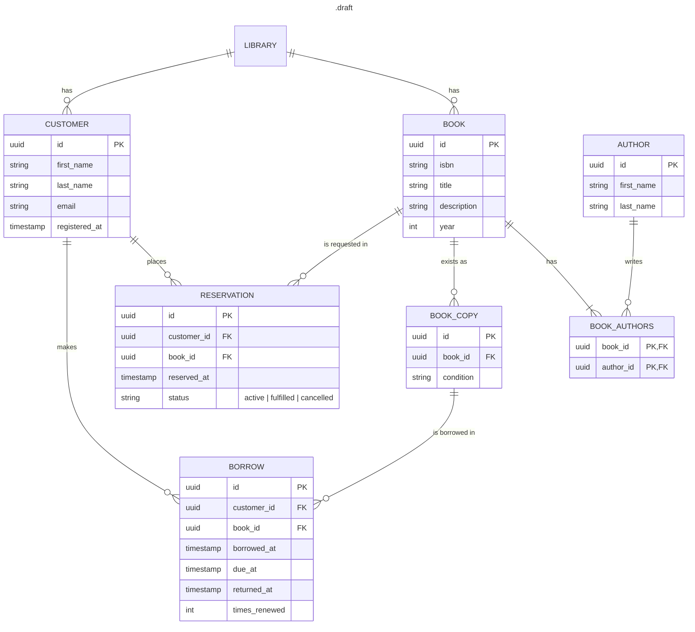

# Bookend

A book library backend. Written in Rust.

## About

This project...

### Features

...

### Restrictions

...

### Tools

**Web framework and runtime**
- **axum** - HTTP routing and Request handling
- **tokio** - Async runtime
- **tower-http** - Prebuilt middleware

**Data**
- **sqlx** - Async PostgreSQL driver
- **serde** - Serialization/deserialization framework
    - **serde_json** - Serde implementation for JSON

**Utilities**
- **uuid** - Generating and parsing UUIDs
- **thiserror** - Convenient derive macros for error handling
- **tracing** - Scoped, structured, and async aware logging and instrumentation
- **tracing-subscriber** - Tools for collecting and formatting tracing events
- **dotenvy** - Environment variable loading

## Getting started

### Prerequisites and Dependencies

- **Docker** and **Docker compose**
- Rust toolchain: **rustc** and **Cargo**)
- **sqlx-cli**

### Installation

Clone the repository and cd into it
```sh
git clone https://github.com/Sky11y/bookend
cd bookend
```

### Configuration

Copy (or rename) the *.env.example* file in the repository root with name
*.env*. This is the file the server and database reads when building the
project. Modify the file with your own values or use as is for testing.
```sh
cp .env.example .env
# OR
mv .env.example .env
```

**Recommended**: Copy the git-hook script to git hooks directory to keep the
sqlx offline query cache updated. Without it run `cargo sqlx prepare` manually
after changing queries or CI will fail. 
```shell
cp scripts/pre-commit .git/hooks/ && chmod +x .git/hooks/pre-commit
```

### Running

1. Bring the database up in detached mode
```sh
docker compose up -d
```
2. Run the migrations for the database
```sh
sqlx migrate run
```
3. Run the server
```sh
# For development build
cargo run
# For release build
cargo run --release
```

**Optional**:
Tracing is by default: `bookend=debug,tower_http=warn,sqlx=warn`. If you want for
example more logging for the development build, use `RUST_LOG` build flag
```sh
RUST_LOG="bookend=debug,tower_http=debug,sqlx=trace" cargo run
````

**Stop the server and bring database down**
1. Use Ctrl+c on the terminal to stop the server.
2. `docker compose down -v` to bring the database down with the volumes.

### Running tests

To run all the tests
```sh
cargo test
```

To run only a particular tests
```sh
cargo test <name>
# For example
cargo test books
```

## Documentation

### Database schema




### API

...

### Design decisions

**Database**
- A separate BOOK_COPY entry instead of a copy count on BOOK
    - allows per-physical-copy properties like *condition* (or shelf location, etc.)
    - each borrow references exactly one copy
- Reservations keep status instead of deletion on fulfill/cancel
    - allows misuse prevention (think of client reserving-cancelling multiple times)
    - allows analytics, if that is preferred.
- Junction table for AUTHOR and BOOK instead of author list on book
    - forced decision by many-to-many relationship
- ModelController to handle all the database queries
    - Handlers are small and go through Controller methods instead of issuing sqlx calls directly
    - confines SQL to one place


## Roadmap

...

## Authors

[Sky11y](https://github.com/Sky11y/)

## License

[MIT]


